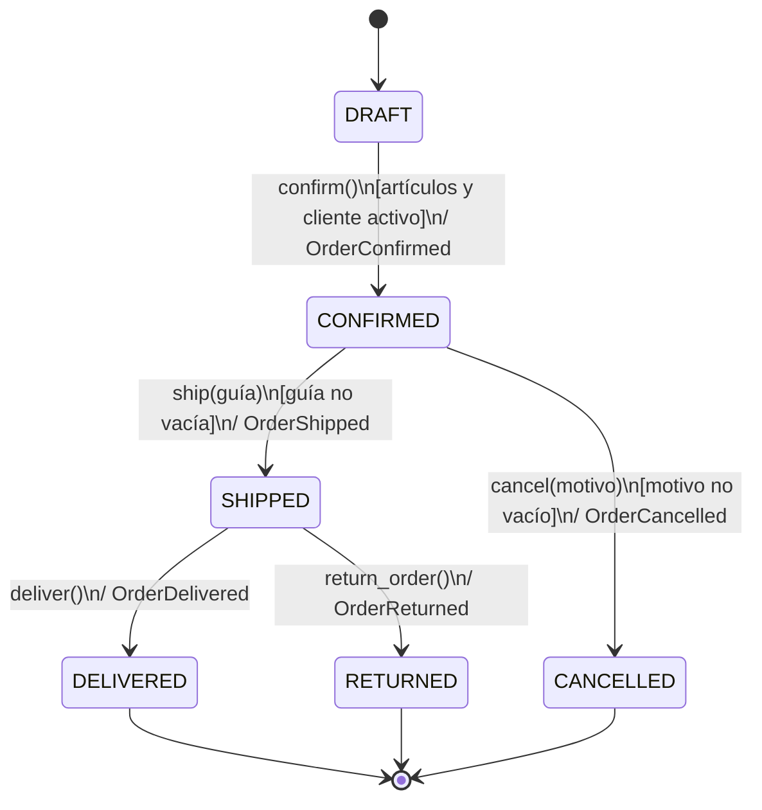

# Reporte · Actividad 4 · TechStore U4

Componentes de Lógica de Negocio · Unidad 4 · FIME · UANL

Equipo 2: Ximena Montserrat Ovalle Vallejo (1999238) · Santiago Almanza Moreno (2001903) · Javier Hernández Huerta (2089204)

Profesor: Miguel Ángel Gómez Marroquín · 28/10/2026

> Versión de consulta rápida. El reporte entregado, con portada, bibliografía, evidencias y conclusiones, es [CLN_AU4_Equipo2_REPORTE.pdf](CLN_AU4_Equipo2_REPORTE.pdf).

## 1. Lectura de los CSV y cálculo manual (sección 5)

Relaciones: `pedidos.cliente_id → clientes.cliente_id`; `detalle_pedidos.pedido_id → pedidos.pedido_id`;
`detalle_pedidos.sku → productos.sku`. Subtotal = cantidad × precio; total = suma de subtotales.

| Pedido | Cliente | Renglones | Unidades | Total manual |
|---|---|---|---|---|
| **O001** | C001 · Ana Torres (VIP, activa) | SKU001 × 2 = 1200.00; SKU002 × 2 = 900.00 | **4** | **2100.00 MXN** |
| O002 | C002 · Luis Medina (no VIP, activo) | SKU001 × 1 = 600.00; SKU002 × 1 = 450.00 | **2** | **1050.00 MXN** |
| O003 | C003 · Carla Ruiz (VIP, inactiva) | SKU001 × 2 = 1200.00; SKU002 × 2 = 900.00 | **4** | **2100.00 MXN** |
| O004 | C004 · Diego Peña (no VIP, inactivo) | SKU004 × 1 = 850.00 | **1** | **850.00 MXN** |
| O005 | C005 · Sofia Lara (VIP, activa) · promoción | SKU001 × 2 = 1200.00; SKU002 × 2 = 900.00 | **4** | **2100.00 MXN** |
| **O006** | C006 · Pedro Soto (no VIP, activo) | SKU008 × 1 = 18000.00 | **1** | **18000.00 MXN** |
| O007 | C007 · Mariana Gil (VIP, activa) | Sin renglones | **0** | **0.00 MXN** |
| O008 | C008 · Raul Vega (no VIP, activo) | SKU003 × 20 = 2400.00 | **20** | **2400.00 MXN** |
| O009 | C009 · Elena Mora (VIP, activa) | SKU003 × 19 = 2280.00 | **19** | **2280.00 MXN** |
| **O010** | C010 · Jorge Luna (no VIP, activo) | SKU003 × 1 = 120.00; SKU009 × 1 = 380.00 | **2** | **500.00 MXN** |
| O011 | C011 · Valeria Rios (VIP, activa) | SKU001 × 1 = 600.00; SKU002 × 2 = 900.00 | **3** | **1500.00 MXN** |
| O012 | C012 · Oscar Nieto (no VIP, activo) | SKU004 × 1 = 850.00 | **1** | **850.00 MXN** |
| O013 | C001 · Ana Torres (VIP, activa) | SKU001 × 1 = 600.00 | **1** | **600.00 MXN** |
| O014 | C002 · Luis Medina (no VIP, activo) | SKU001 × 1 = 600.00 | **1** | **600.00 MXN** |
| O015 | C005 · Sofia Lara (VIP, activa) | SKU002 × 1 = 450.00 | **1** | **450.00 MXN** |
| O016 | C007 · Mariana Gil (VIP, activa) | SKU011 × 1 = 2100.00 | **1** | **2100.00 MXN** |

Los 16 valores coinciden con la salida de `python cargar_csv.py`. O001, O006 y O010 (en negritas)
son los de la actividad corta y se comprueban en `tests/test_domain.py::test_tabla_calculo_manual`.
O007 no tiene renglones (total 0.00); O008 alcanza exactamente el límite de 20 unidades y O009 queda en 19.

## 2. Modelo de dominio

| Elemento | Tipo DDD | Invariantes |
|---|---|---|
| `Money` | Value Object inmutable | `Decimal` obligatorio, ≥ 0, finito; `add()` exige misma moneda y devuelve un objeto nuevo |
| `OrderItem` | Value Object inmutable | SKU no vacío, cantidad entera > 0; `subtotal` calculado |
| `Customer` | Entidad (identidad `id`) | id no vacío; `is_vip`, `active` |
| `Order` | Entidad · Aggregate Root | ≤ 20 unidades, solo MXN, artículos solo en DRAFT, transiciones controladas |
| `DomainEvent` | Objeto inmutable | nombre en pasado, `order_id`, `occurred_at` (UTC), `details` |

Jerarquía de excepciones:

```
DomainException
└── OrderException
    ├── InvalidOrderData          → HTTP 422
    ├── InvalidOrderTransition    → HTTP 409
    └── OrderItemLimitExceeded    → HTTP 422
NotFound (capa de aplicación)     → HTTP 404
```

## 3. Specifications

| Specification | Condición |
|---|---|
| `MinimumAmountSpec(Decimal("500"))` | total **>** 500 (estricto) |
| `VIPCustomerSpec()` | cliente VIP |
| `MinimumUnitsSpec(4)` | unidades **≥** 4 |
| `ActivePromotionSpec()` | pedido con promoción |

```python
TEN_PERCENT  = MinimumAmountSpec(Decimal("500")) & VIPCustomerSpec() & MinimumUnitsSpec(4) & ~ActivePromotionSpec()
FIVE_PERCENT = MinimumAmountSpec(Decimal("5000")) & ~ActivePromotionSpec()
ANY_DISCOUNT = TEN_PERCENT | FIVE_PERCENT      # AND, OR y NOT
```

`DiscountPolicy.evaluate()` aplica primero el 10 % y, si no se cumple, el 5 %. Ninguna
Specification modifica el pedido (`test_specification_no_modifica_pedido`).

| Pedido | 10 % | 5 % | Resultado |
|---|---|---|---|
| O001 | ✔ | ✘ | 10 % → 2100.00 − 210.00 = 1890.00 |
| O006 | ✘ (no VIP, 1 unidad) | ✔ | 5 % → 18000.00 − 900.00 = 17100.00 |
| O005 | ✘ (promoción) | ✘ (promoción) | 0 % |
| O010 | ✘ (500 no es > 500) | ✘ | 0 % |

## 4. Diagrama de estados



```
DRAFT --confirm--> CONFIRMED --ship--> SHIPPED --deliver--> DELIVERED
                       |                  |
                    cancel             return
                       |                  |
                   CANCELLED           RETURNED
```

| Transición | Estado requerido | Condición adicional | Si falla |
|---|---|---|---|
| `add_item(item)` | DRAFT | unidades + cantidad ≤ 20; MXN | `InvalidOrderTransition` / `OrderItemLimitExceeded` / `InvalidOrderData` |
| `confirm()` | DRAFT | artículos y cliente activo | `InvalidOrderTransition` / `InvalidOrderData` |
| `ship(guía)` | CONFIRMED | guía no vacía | `InvalidOrderTransition` / `InvalidOrderData` |
| `cancel(motivo)` | CONFIRMED | motivo no vacío | `InvalidOrderTransition` / `InvalidOrderData` |
| `deliver()` | SHIPPED | — | `InvalidOrderTransition` |
| `return_order()` | SHIPPED | — | `InvalidOrderTransition` |

Transiciones inválidas de ejemplo: cancelar desde SHIPPED (E13), confirmar desde CONFIRMED (E12),
cancelar desde DRAFT, entregar desde CONFIRMED. DELIVERED, CANCELLED y RETURNED son estados finales.

## 5. Domain Events

Un Domain Event registra un hecho que **ya ocurrió**; por eso su nombre está en pasado.
Cada método de transición sigue el mismo orden: **validar → cambiar `status` → registrar evento**.
Si una validación falla, se lanza la excepción antes de tocar el estado, así que el pedido no
cambia y no se anuncia un hecho falso.

| Evento | Se emite en | Datos (`details`) |
|---|---|---|
| `OrderConfirmed` | `confirm()` | `customer_id`, `total`, `units` |
| `OrderShipped` | `ship()` | `customer_id`, `tracking_number` |
| `OrderCancelled` | `cancel()` | `customer_id`, `reason` |
| `OrderDelivered` | `deliver()` | `customer_id` |
| `OrderReturned` | `return_order()` | `customer_id` |

Todos incluyen `order_id` y `occurred_at` en UTC. El pedido acumula los eventos en `order.events`;
en un sistema real, la unidad de trabajo los publicaría a suscriptores (correo, facturación,
inventario) sin que `Order` conozca a esos suscriptores. Ejemplo verificado (E14):
`OrderConfirmed → OrderShipped → OrderReturned`.

## 6. Escenarios E01–E15

Resultado: **15/15** cumplen su objetivo. Bitácora completa con precondiciones, operación,
resultado, evento y prueba en [BITACORA_E01_E15.md](BITACORA_E01_E15.md).

## 7. Reflexión: tres errores encontrados

1. **`ModuleNotFoundError: No module named 'app.domain'`.** Al ejecutar `python cargar_csv.py`
   antes de escribir el dominio, el cargador falló porque importa `Customer`, `Order`,
   `OrderItem` y `Money`. Lo solucioné creando `app/domain.py` con esos nombres y con el
   constructor `Order(customer=..., id=..., has_promotion=...)` que espera el cargador.
   Aprendí que el cargador es un contrato: mis clases deben respetar sus nombres y parámetros.
2. **El pedido vacío O007 mostraba total `0` en lugar de `0.00`.** La suma empezaba en
   `Decimal("0")`, que no tiene decimales. Lo corregí iniciando en `Decimal("0.00")`.
   Aprendí que `Decimal` conserva la escala y que por eso es adecuado para dinero.
3. **El paquete traía una carpeta `__pycache__`.** Si se sube a GitHub incumple la entrega.
   Agregué `.gitignore` con `.venv/`, `__pycache__/` y `*.pyc`, y no copié esa carpeta.

Además validé las pruebas rompiendo reglas a propósito: al cambiar `>` por `>=` en
`MinimumAmountSpec`, fallaron 2 pruebas (O010 con 500 exactos); al permitir 21 unidades,
fallaron 5. Con el código correcto, las 69 pasan. Aprendí que una prueba útil debe fallar
cuando la regla se rompe, y que si una prueba falla se corrige la implementación, no el
resultado esperado.

## 8. Preguntas para el reporte

**¿Por qué se usa Decimal en lugar de float para precios?**
`float` es binario y no representa exactamente valores como 0.1; `0.1 + 0.2` da
`0.30000000000000004`. `Decimal` representa los centavos con exactitud y conserva la escala
(`600.00`), por lo que sumas y descuentos no acumulan errores. Además se construye desde
texto (`Decimal("600.00")`), no desde un float.

**¿Cuál es la diferencia entre contar renglones y sumar unidades?**
Un renglón es un `OrderItem`; puede tener varias unidades. O008 tiene **1** renglón con **20**
unidades. El límite es de 20 **unidades**, por eso `units` suma `quantity`: O009 tiene 19
unidades en un renglón y agregar 2 más (21) se rechaza aunque solo serían 2 renglones.

**¿Qué ventaja tiene encapsular una regla en Specification?**
La regla tiene nombre, se prueba por separado y se combina con `&`, `|` y `~` sin duplicar
condiciones en la API u otros servicios. Si cambia el umbral de 500 se edita un solo lugar, y
como solo evalúa, no puede alterar el pedido.

**¿Por qué los eventos se registran solo después de una transición válida?**
Un evento afirma que algo ya sucedió. Si se registrara antes de validar, una operación
rechazada (por ejemplo, el segundo `confirm()` de E12) anunciaría un hecho falso y los
suscriptores enviarían correos o facturas indebidas.

**¿Qué parte del código podrías reutilizar si reemplazas FastAPI por otra interfaz?**
Todo `app/domain.py`, `app/specifications.py` y `app/services.py`, además de `cargar_csv.py`
y las pruebas de dominio. Solo cambiaría `app/api.py`. Prueba de ello:
`ejecutar_escenarios.py` usa el mismo dominio desde la consola, sin servidor web.

## 9. Lista de verificación (sección 14)

| Punto | Estado | Evidencia |
|---|---|---|
| Puedo ejecutar `python cargar_csv.py` sin errores | ✅ | `evidencias/01_carga_16_pedidos.png` |
| O001 muestra 4 unidades y 2100.00 MXN | ✅ | misma captura; `test_pedido_o001_inicia_draft` |
| La regla del 10 % requiere VIP, >500, ≥4 unidades y ausencia de promoción | ✅ | `TEN_PERCENT`; E01, E04, E09, E10 |
| La regla del 5 % requiere >5000 y ausencia de promoción | ✅ | `FIVE_PERCENT`; E05; `test_cinco_por_ciento_umbral_estricto` |
| Una operación inválida no cambia el estado ni añade eventos | ✅ | bitácora (“sin cambios”); E03, E06, E08, E11–E13 |
| La API responde 404, 409 y 422 en los casos indicados | ✅ | `evidencias/12_uvicorn_log_200_409_422_404.png`, `08`–`10`, `04_api_curl.txt`, `tests/test_api.py` |
| pytest termina sin fallos | ✅ | `evidencias/05_pytest.png` (69 passed) |
| El repositorio contiene README y evidencias | ✅ | `README.md`, `docs/`, `evidencias/` |
